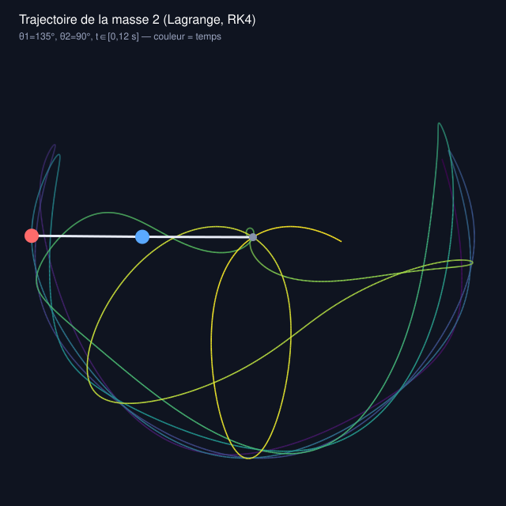
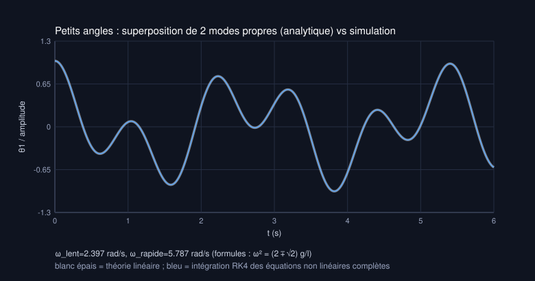
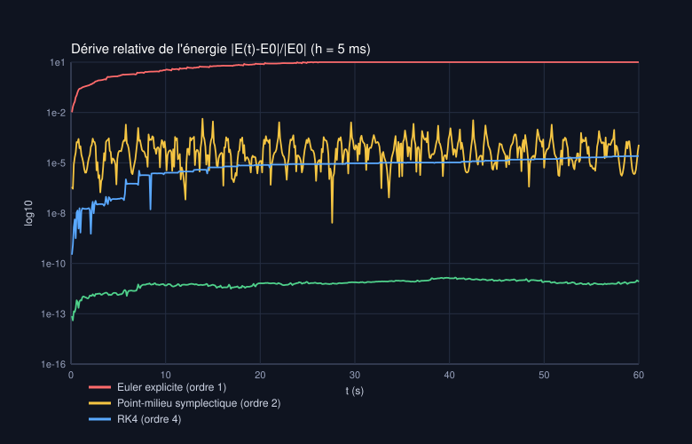
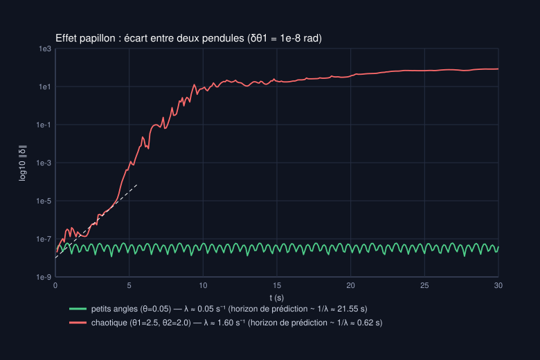
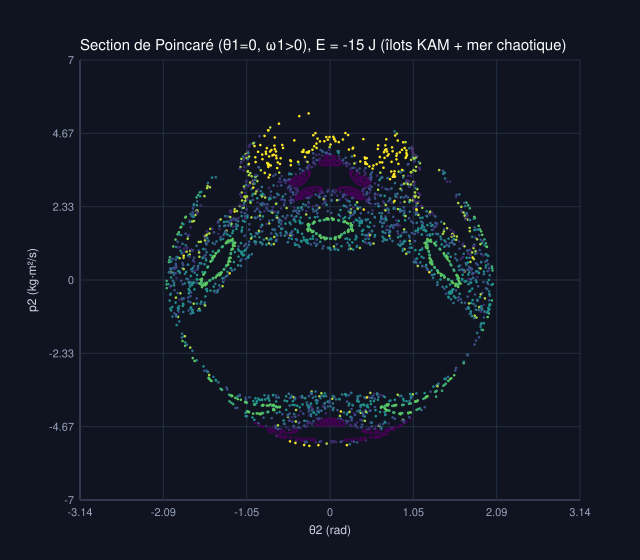

# Pendule double — mécanique de Lagrange, Hamilton et chaos

Simulation C++ (SDL2) d'un pendule double **avec la mécanique analytique complète** : Lagrangien,
équations d'Euler-Lagrange, formalisme hamiltonien, dissipation de Rayleigh, théorie linéaire des
modes propres, intégrateurs d'ordre 4 / adaptatif / symplectique, exposant de Lyapounov et section de Poincaré.
Chaque résultat physique est **vérifié par des tests automatiques** (`make test`).



## Utilisation

```bash
sudo apt install libsdl2-dev        # SDL2 (Debian/Ubuntu)
make                                # construit le simulateur, les tests et l'outil de figures
./double_pendulum                   # valeurs par défaut
./double_pendulum 1.0 0.7 120 -10   # l1 l2 θ1(°) θ2(°)         (entrées d'origine du projet)
./double_pendulum 1 1 120 -10 2 1   # … m1 m2 (kg)
./double_pendulum 1 1 120 -10 1 1 0.15   # … coefficient de frottement c
make test                           # 15 vérifications physiques
make figures                        # régénère figures/*.svg
```

| Touche / souris | Action |
|---|---|
| `Espace` | pause |
| `R` | recommencer |
| `T` | afficher/masquer le **jumeau rouge** (perturbé de 10⁻⁶ rad : effet papillon) |
| `D` | frottement on/off |
| `↑` `↓` | vitesse du temps |
| `C` | effacer les traînées |
| `S` | capture d'écran (`capture.bmp`) |
| clic-glisser sur une masse | fixer les conditions initiales à la souris |

Le titre de la fenêtre affiche en direct : énergie `E = T + V`, exposant de Lyapounov, écart entre les deux pendules, tensions des fils.
Panneaux : énergies T (jaune), V (vert), E (blanc) avec dérive relative · portrait de phase (θ₁, ω₁) · écart du jumeau (échelle log).

## La physique

**Coordonnées généralisées** : θ₁, θ₂ (angles à la verticale descendante). Les liaisons (fils rigides) sont éliminées.

**Énergies** (δ = θ₁ − θ₂) :

```
T = ½(m₁+m₂) l₁² θ̇₁² + ½ m₂ l₂² θ̇₂² + m₂ l₁ l₂ θ̇₁ θ̇₂ cos δ
V = −(m₁+m₂) g l₁ cos θ₁ − m₂ g l₂ cos θ₂
L = T − V
```

**Équations d'Euler-Lagrange** `d/dt(∂L/∂θ̇ᵢ) − ∂L/∂θᵢ = Qᵢ` avec Q = −c θ̇ (dissipation de Rayleigh) :

```
⎡ (m₁+m₂) l₁²     m₂ l₁ l₂ cos δ ⎤ ⎡θ̈₁⎤   ⎡ −m₂ l₁ l₂ θ̇₂² sin δ − (m₁+m₂) g l₁ sin θ₁ − c θ̇₁ ⎤
⎣ m₂ l₁ l₂ cos δ     m₂ l₂²      ⎦ ⎣θ̈₂⎦ = ⎣ +m₂ l₁ l₂ θ̇₁² sin δ −     m₂ g l₂ sin θ₂ − c θ̇₂ ⎦
```

La matrice de masse est inversée exactement (déterminant ≥ m₁m₂l₁²l₂² > 0 : jamais singulier). Les termes en θ̇² sont les forces
centrifuge et de Coriolis.

**Formalisme hamiltonien** : moments conjugués `pᵢ = ∂L/∂θ̇ᵢ`, hamiltonien `H(θ,p) = T + V`
(la transformée de Legendre est testée : `H(θ,p) = T+V` à 10⁻¹²). Le flux conserve le volume de l'espace des phases (Liouville).

**Bilan d'énergie avec frottement** : `dE/dt = −c (θ̇₁² + θ̇₂²)` — vérifié numériquement.

**Tensions** (projection de la 2ᵉ loi de Newton sur les fils, tout est tiré de la solution Lagrangienne) :
`T₂ = m₂[g cos θ₂ + l₂θ̇₂² + l₁(θ̈₁ sin δ + θ̇₁² cos δ)]`, `T₁ = T₂ cos δ + m₁(g cos θ₁ + l₁θ̇₁²)`.
Un test recompose Newton en coordonnées cartésiennes par différences finies (résidu 10⁻⁶).

**Petits angles — modes propres** : `det(K − ω²M₀) = 0`. Pour m₁=m₂, l₁=l₂ : **ω² = (2 ∓ √2) g/l**
(2,397 et 5,787 rad/s). La simulation non linéaire reproduit la solution analytique à 3·10⁻⁷ :



## Intégrateurs et conservation de l'énergie

| Schéma | Ordre | Remarque |
|---|---|---|
| Euler explicite | 1 | **énergie divergente** (gardé comme contre-exemple : l'ancienne version l'utilisait) |
| Point-milieu implicite en (θ, p) | 2 | **symplectique** : énergie bornée à long terme, pas de dérive |
| RK4 | 4 | schéma du simulateur ; ordre mesuré ≈ 4,2 |
| Dormand-Prince 5(4) | 5 | pas adaptatif, dérive ~10⁻¹² |



## Chaos

Le système est **chaotique** dès que l'énergie est suffisante : deux pendules séparés de 10⁻⁸ rad divergent exponentiellement,
`δ(t) ≈ δ₀ e^{λt}`. L'exposant de Lyapounov λ est mesuré par l'algorithme de Benettin (renormalisation périodique) :
≈ 0,05 s⁻¹ (≈ 0, régulier) pour de petits angles, ≈ 1,6 s⁻¹ en régime chaotique, soit un horizon de prédictibilité ~ 1/λ ≈ 0,6 s.



À basse énergie, le mouvement est quasi-périodique (tores KAM) ; à haute énergie il remplit l'espace des phases :


**Section de Poincaré** (à E fixée, plan θ₁ = 0, θ̇₁ > 0, coordonnées (θ₂, p₂)) : îlots réguliers entourés d'une mer chaotique,
scénario typique d'un système hamiltonien non intégrable (théorème KAM) :



**Carte du chaos** : temps avant le premier retournement de la masse 2, selon les angles initiaux (repos). Zone jaune : basse énergie,
jamais de retournement. Les filaments fins sont la signature de la sensibilité aux conditions initiales :


## Ce qui a changé par rapport à l'ancienne version

- Les équations de l'ancien `main.cpp` n'étaient pas celles du pendule double (termes en `θ` à la place de `cos δ`, masses absentes) :
  elles sont remplacées par les équations de Lagrange exactes, **avec les deux masses**.
- Euler explicite (non conservatif) remplacé par RK4 ; l'énergie est maintenant suivie à l'écran.
- La fonction `SDL_RenderFillCircle` n'existe pas dans SDL2 (le code ne compilait pas) ; l'include `../include/SDL.h` est remplacé par `<SDL2/SDL.h>`.
- Ajout : frottement, jumeau pour l'effet papillon, Lyapounov, portrait de phase, interaction souris, tests physiques, figures.

## Fichiers

| Fichier | Rôle |
|---|---|
| `pendulum.hpp` | toute la physique (sans dépendance) |
| `main.cpp` | simulateur interactif SDL2 |
| `analysis.cpp` | génère `figures/*.svg` |
| `test_physics.cpp` | 15 tests de validation (Legendre, Euler-Lagrange, modes propres, énergie, ordre RK4, Newton, dissipation, Lyapounov) |
